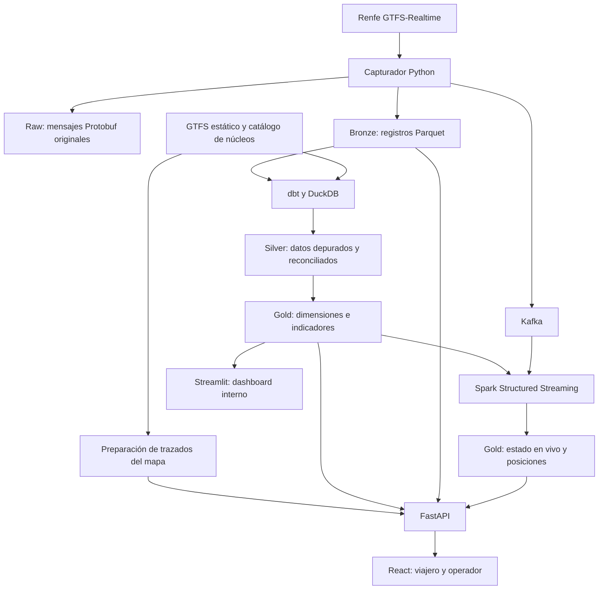

# Anticipa · Piloto de datos de Cercanías

Este repositorio contiene el código del piloto desarrollado como parte del **Trabajo Fin de Máster (TFM) del proyecto Anticipa: Plataforma de Monitorización de la Red de Cercanías**. Incluye la captura, conservación y análisis de información de Cercanías Renfe y un cuadro de mando para revisar el estado publicado por Renfe y demostrar cómo una observación pasa del mensaje original al indicador.

## Integrantes del proyecto

- Benito García
- Miguel Ligero García-Morato
- Erasmo Javier Bello Gerez
- María Martín Bru
- José María Cortés Céspedes.

## La demo

La demo permite recorrer el flujo de datos y consultar sus resultados desde tres pantallas.

### Aplicación de viajero

Ofrece una vista de las líneas, los próximos trenes y los avisos del núcleo y la estación seleccionados. Permite guardar preferencias en el navegador, como el núcleo, la estación de referencia y la línea habitual. El panel de predicción muestra valores de ejemplo con el aviso **PREDICCIÓN SIMULADA**.

### Centro de control del operador

Reúne la puntualidad, el retraso medio, los trenes activos, las incidencias y el estado por línea del núcleo seleccionado. Incluye:

- Un mapa con trazados GTFS, estaciones y posiciones recientes de los trenes. El fondo se muestra en blanco y gris para facilitar la lectura de las líneas.
- Avisos con su texto completo. Se incluyen los que informan estaciones del núcleo seleccionado; el contador y el detalle utilizan el mismo filtro.
- Tendencias de las últimas dos horas, agrupadas cada cinco minutos: retraso medio, percentil 90 y porcentaje de trenes puntuales. El percentil 90 ayuda a detectar retrasos altos que la media puede ocultar.
- Predicciones de ejemplo identificadas como simuladas.

El mapa aparece plegado. Al abrirlo, consulta las posiciones cada 30 segundos y oculta las de más de cinco minutos. Las tendencias se actualizan cada minuto y cuentan cada viaje una vez por intervalo. El criterio de puntualidad es un retraso inferior a cinco minutos.

### Dashboard interno

El dashboard de Streamlit permite consultar indicadores históricos y de calidad de los datos. Cada vista histórica informa del periodo disponible.

## Alcance del piloto

El piloto implementa la captura de los feeds GTFS-Realtime de Renfe, la conservación de los mensajes originales, su transformación a datos tabulares y la publicación de indicadores. Utiliza GTFS estático y un catálogo de estaciones por núcleo para relacionar viajes, líneas, estaciones y trazados.

Los datos en vivo dependen de lo que publica Renfe. La consulta cada 30 segundos no garantiza que la fuente haya publicado una posición nueva. Puede haber información ausente, antigua o sin correspondencia con el catálogo estático. Los avisos sin estaciones informadas quedan fuera del listado de incidencias de cada núcleo.

Esta versión contiene únicamente los componentes de la demo. Las predicciones son ejemplos fijos y contienen valores ficticios. No se entrenan modelos ni se ejecuta inferencia; el aviso explica que las predicciones reales requerirían incorporar y entrenar un modelo.

El despliegue está preparado para una demostración en una red de confianza y puede ejecutarse en un LXC compartido con límites de recursos. El acceso del operador requiere usuario y contraseña. Los datos, las credenciales y las copias locales se mantienen fuera del repositorio.

## Tecnología aplicada

| Tecnología | Uso en el proyecto |
|---|---|
| Python y GTFS-Realtime/Protobuf | Descarga y lectura de posiciones, actualizaciones de viaje y avisos de Renfe. |
| Parquet y PyArrow | Conservación de registros tabulares y publicación de conjuntos de datos. |
| Apache Kafka | Transporte de las observaciones hacia el procesamiento continuo. |
| Spark Structured Streaming | Procesamiento en microbatches y mantenimiento del último estado por viaje y vehículo. |
| DuckDB y dbt | Consultas analíticas, transformaciones SQL, dimensiones, indicadores y pruebas de datos. |
| FastAPI | API para viajero, operador, mapas, tendencias y estado del sistema. |
| React y Vite | Interfaz de viajero y centro de control. |
| Leaflet y OpenStreetMap | Visualización cartográfica de trazados, estaciones y trenes. |
| Streamlit y Altair | Dashboard interno de histórico y calidad. |
| Docker Compose y nginx | Despliegue de servicios, publicación de la web y autenticación del operador. |

## Arquitectura y recorrido del dato

La arquitectura combina una ruta de procesamiento continuo para las pantallas en vivo con una ruta por lotes para el análisis histórico.



1. **Captura y conservación.** El capturador consulta los feeds, omite snapshots repetidos según su marca temporal y guarda tanto el mensaje original como las filas extraídas. Publica las observaciones en Kafka para el procesamiento continuo.
2. **Estado en vivo.** Spark consume las actualizaciones de viaje y las posiciones en microbatches de 30 segundos. Mantiene el último estado disponible, lo enriquece con dimensiones y escribe los archivos de consulta de forma atómica.
3. **Análisis histórico.** dbt y DuckDB transforman los registros Bronze en capas Silver y Gold. Se construyen dimensiones e indicadores de puntualidad, retrasos, cobertura e ingesta.
4. **Consulta y visualización.** FastAPI sirve el estado en vivo, los datos del mapa y los resultados analíticos. Los avisos y las tendencias recientes se calculan desde Bronze. React presenta las vistas de viajero y operador; Streamlit consulta los archivos Gold del estado en vivo y de los indicadores históricos.

Por ejemplo, una actualización de viaje con retraso se conserva en su mensaje original y en Bronze, pasa por Kafka y Spark y termina en el estado consultado por el operador. Ese mismo registro puede contribuir después a los indicadores históricos mediante dbt. Los archivos originales permiten volver a revisar la información recibida.

Los trazados del mapa se preparan a partir de `shapes.txt` y de los viajes y paradas de la misma versión GTFS, y se distribuyen por núcleo.

## Arranque desde una copia nueva

Requisitos: Docker Engine con Compose v2 o posterior, Python 3 y OpenSSL para generar las credenciales iniciales. Se necesita acceso a Internet a Renfe para los datos y a OpenStreetMap para el fondo cartográfico.

```sh
make init
make config
make bootstrap
make up
```

`make init` crea `.env` y `.secrets/operator.htpasswd` si faltan. Las credenciales del operador se guardan en `.secrets/access.txt`. No sustituye credenciales existentes. No publiques estos archivos.

`make bootstrap` descarga el GTFS completo y los catálogos de núcleos, genera el mapa directamente desde el ZIP oficial y construye únicamente las dimensiones de dbt. No necesita histórico Bronze previo ni entrena modelos. La geometría y los identificadores proceden de la misma versión GTFS. Si Renfe no publica un archivo requerido, la preparación termina con error en vez de inventar datos.

Las pantallas inicialmente mostrarán datos en cuanto lleguen los primeros eventos. Un inicio desde cero no incluye datos históricos. Las tendencias dejan huecos hasta que haya observaciones reales.

| Pantalla | Dirección por defecto |
|---|---|
| Viajero | http://localhost:3000 |
| Operador, con usuario y contraseña | http://localhost:3000/operador |
| Dashboard interno | http://localhost:18501 |
| API, accesible desde el host | http://127.0.0.1:18000/docs |

Los puertos y direcciones de escucha se configuran en `.env`. El puerto 8501 del host queda libre. El acceso web está pensado para una red de confianza; la API de operación se mantiene con token y nginx pide autenticación en `/operador` y `/api-op/`.

## Despliegue compartido en un LXC

Usa el mismo Compose y el complemento con límites de recursos:

```sh
make COMPOSE="docker compose -f docker-compose.yml -f deploy/lxc/compose.yml" bootstrap
make COMPOSE="docker compose -f docker-compose.yml -f deploy/lxc/compose.yml" up
```

Consulta [la guía de despliegue](deploy/lxc/LEEME.md). No hay un Compose privado con secretos que sea necesario copiar al repositorio.

## Operación de la demo

```sh
make gtfs               # Nueva versión GTFS, incluido shapes cuando existe
make nucleos            # Catálogo estación → núcleo
make mapa               # Regenera el mapa desde el último ZIP descargado
make dbt                # Reconstruye histórico Silver/Gold cuando exista Bronze
make dbt-test
make ps
make logs
make down               # Conserva datos y volúmenes
```

Los indicadores históricos originales agrupan por código de línea sin núcleo y no deben presentarse como comparación entre ciudades. Las tendencias nuevas calculan el núcleo por la estación de cada viaje.

## Desarrollo y pruebas

```sh
python3 -m venv .venv
. .venv/bin/activate
pip install -r services/api/requirements-dev.txt
./scripts/test.sh
```

Para desarrollo de la API se recomienda Python 3.12, igual que en Docker.

Para editar la interfaz con recarga automática:

```sh
cd services/webapp
npm ci
npm run dev
```

El proxy de desarrollo envía `/api` y `/api-op` al nginx de la aplicación. Conserva la autenticación del operador. Su destino predeterminado es `http://127.0.0.1:3000`; puede cambiarse con `DEV_PROXY_TARGET` en el entorno del proceso Vite. Las dependencias web se fijan mediante `package-lock.json` y se instalan con `npm ci`.

Las pruebas Python cubren aislamiento por núcleo, caducidad de posiciones, tendencias, autenticación, consultas de la demo, generación idempotente de credenciales y construcción del mapa sin archivos intermedios manuales. Las comprobaciones de navegador deben incluir abrir/cerrar el mapa, cambio de núcleo y varios refrescos para evitar la regresión de tarjetas duplicadas.

## Estructura y datos

- `services/ingestor`, `services/stream`: captura y procesamiento en vivo.
- `services/api`: API de la demo, mapa y tendencias.
- `services/webapp`: viajero y operador.
- `services/dashboard`: Streamlit e histórico.
- `dbt`: modelos Silver/Gold, dimensiones y tests.
- `scripts`: inicialización, descarga de catálogos, preparación del mapa y pruebas.
- `data/`: datos y artefactos locales, excluidos del repositorio.
- `.secrets/`: credenciales locales, excluidas del repositorio.

`.gitignore` excluye entornos privados, credenciales, archivos de datos, copias comprimidas, dependencias, builds, registros y cachés. `bronze.gz` puede conservarse como copia local; no forma parte del código publicable.

Fuentes: Renfe Open Data (GTFS y GTFS-Realtime), OpenStreetMap para la cartografía. La captura o la presencia de archivos no acredita por sí sola la disponibilidad ni la calidad de todos los servicios.
